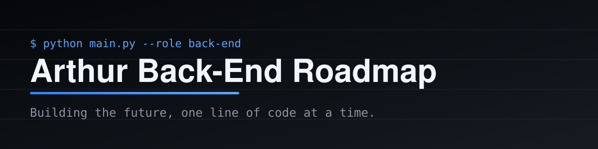
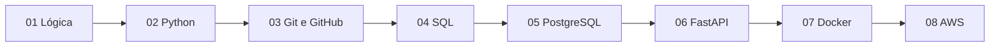

<div align="center">



# Arthur Back-End Roadmap

**Building the future, one line of code at a time.**


[](https://github.com/artnnsndev)

[🗺️ Roadmap](ROADMAP.md) · [📊 Study Tracker](STUDY-TRACKER.md) · [📚 Resources](RESOURCES.md) · [🤝 Contributing](CONTRIBUTING.md)

</div>

---

## 👋 Sobre o projeto

Este repositório é a minha **plataforma de estudos** para me tornar Desenvolvedor Back-End. Em vez de uma lista solta de links, aqui cada módulo tem objetivos, conteúdo, aulas em vídeo com preview, documentação oficial, exercícios, projetos e critérios claros de conclusão.

## 🙋‍♂️ Sobre mim

| | |
|---|---|
| **Nome** | Arthur Nunes |
| **GitHub** | [@artnnsndev](https://github.com/artnnsndev) |
| **Área** | Back-End Development |
| **Linguagem principal** | Python |

## 🎯 Objetivo profissional

Atuar como **Back-End Developer**, construindo APIs seguras, bem testadas e prontas para produção.

## 🧰 Stack alvo

> Estas são as tecnologias que **estou aprendendo**. Nenhuma está marcada como dominada; o progresso real fica no [Study Tracker](STUDY-TRACKER.md).

     

## 🗺️ Roadmap visual



Detalhes e ordem de estudo em [ROADMAP.md](ROADMAP.md).

## 📚 Módulos

| # | Módulo | Professor / canal | Pasta |
|---|--------|-------------------|-------|
| 01 | Lógica de programação | Gustavo Guanabara — Curso em Vídeo | [01-programming-logic](01-programming-logic/README.md) |
| 02 | Python (Mundos 1, 2 e 3) | Gustavo Guanabara — Curso em Vídeo | [02-python](02-python/README.md) |
| 03 | Git e GitHub | Gustavo Guanabara — Curso em Vídeo | [03-git-github](03-git-github/README.md) |
| 04 | SQL e bancos de dados | Bóson Treinamentos | [04-sql-databases](04-sql-databases/README.md) |
| 05 | PostgreSQL | Bóson Treinamentos | [05-postgresql](05-postgresql/README.md) |
| 06 | FastAPI | Eduardo Mendes (Dunossauro) | [06-fastapi](06-fastapi/README.md) |
| 07 | Docker | Jeferson Fernando / LINUXtips | [07-docker](07-docker/README.md) |
| 08 | AWS Cloud | Mundo da Cloud + AWS Skill Builder | [08-aws-cloud](08-aws-cloud/README.md) |

## 📈 Progresso de aprendizagem

> Atualize esta tabela conforme avançar. Legenda: ⬜ não iniciado · 🟦 em andamento · ✅ concluído.

| Módulo | Status |
|--------|:------:|
| 01 — Lógica de programação | ⬜ |
| 02 — Python | ⬜ |
| 03 — Git e GitHub | ⬜ |
| 04 — SQL | ⬜ |
| 05 — PostgreSQL | ⬜ |
| 06 — FastAPI | ⬜ |
| 07 — Docker | ⬜ |
| 08 — AWS | ⬜ |

Acompanhamento detalhado (aulas, exercícios e projetos) em [STUDY-TRACKER.md](STUDY-TRACKER.md).

## 👨‍🏫 Cursos e professores

| Tema | Professor / canal | Fonte |
|------|-------------------|-------|
| Algoritmos e lógica | Gustavo Guanabara | [Curso em Vídeo](https://www.cursoemvideo.com/curso/curso-de-algoritmo/) |
| Python 3 (Mundos 1–3) | Gustavo Guanabara | [Curso em Vídeo](https://www.cursoemvideo.com/) |
| Git e GitHub | Gustavo Guanabara | [Curso em Vídeo](https://www.cursoemvideo.com/curso/curso-de-git-e-github/) |
| SQL e PostgreSQL | Bóson Treinamentos | [YouTube](https://www.youtube.com/@bosontreinamentos) |
| FastAPI | Eduardo Mendes (Dunossauro) | [YouTube](https://www.youtube.com/@Dunossauro) · [Curso escrito](https://fastapidozero.dunossauro.com/) |
| Docker | Jeferson Fernando / LINUXtips | [YouTube](https://www.youtube.com/@LINUXtips) |
| AWS | Mundo da Cloud | [AWS Skill Builder](https://skillbuilder.aws/) |

## 🛠️ Projetos práticos

| Nível | Projeto | Onde |
|-------|---------|------|
| 🟢 Iniciante | Calculadora em Python | [02-python/projects](02-python/projects/README.md#calculadora-em-python) |
| 🟢 Iniciante | Conversor de moedas | [02-python/projects](02-python/projects/README.md#conversor-de-moedas) |
| 🟢 Iniciante | Sistema de cadastro | [02-python/projects](02-python/projects/README.md#sistema-de-cadastro) |
| 🟢 Iniciante | Gerenciador de tarefas em terminal | [02-python/projects](02-python/projects/README.md#gerenciador-de-tarefas-em-terminal) |
| 🟡 Intermediário | API de tarefas com FastAPI | [06-fastapi/projects](06-fastapi/projects/README.md#api-de-tarefas-com-fastapi) |
| 🟡 Intermediário | Sistema CRUD com PostgreSQL | [05-postgresql/projects](05-postgresql/projects/README.md) |
| 🟡 Intermediário | API de autenticação | [06-fastapi/projects](06-fastapi/projects/README.md#api-de-autenticação) |
| 🔴 Avançado | API completa com FastAPI e PostgreSQL | [06-fastapi/projects](06-fastapi/projects/README.md#api-completa-com-fastapi-e-postgresql) |
| 🔴 Avançado | Aplicação com Docker Compose | [07-docker/projects](07-docker/projects/README.md) |
| 🔴 Avançado | Deploy de uma API na AWS | [08-aws-cloud/projects](08-aws-cloud/projects/README.md) |

## 📖 Documentações oficiais

- [Git](https://git-scm.com/doc) · [GitHub Docs](https://docs.github.com/pt)
- [PostgreSQL Tutorial](https://www.postgresql.org/docs/current/tutorial.html)
- [FastAPI Tutorial](https://fastapi.tiangolo.com/tutorial/)
- [Docker — Get started](https://docs.docker.com/get-started/)
- [AWS Skill Builder](https://skillbuilder.aws/)

Lista completa e status de verificação dos links em [RESOURCES.md](RESOURCES.md).

## 🗂️ Estrutura do repositório

```text
backend-roadmap/
├── README.md
├── ROADMAP.md
├── STUDY-TRACKER.md
├── RESOURCES.md
├── CONTRIBUTING.md
├── 01-programming-logic/   (README + exercises/)
├── 02-python/              (README + world-01..03 + projects/)
├── 03-git-github/
├── 04-sql-databases/       (README + exercises/)
├── 05-postgresql/          (README + projects/)
├── 06-fastapi/             (README + projects/)
├── 07-docker/              (README + projects/)
├── 08-aws-cloud/           (README + projects/)
└── assets/images/
```

## 🔎 Sobre a verificação dos links

Todo link de vídeo ou playlist foi conferido por fontes públicas. O que **não** pôde ser confirmado está marcado como **"Link pendente de verificação"** em vez de inventado. Veja o status em [RESOURCES.md](RESOURCES.md).

---

<div align="center">

*"Building the future, one line of code at a time."*

</div>
